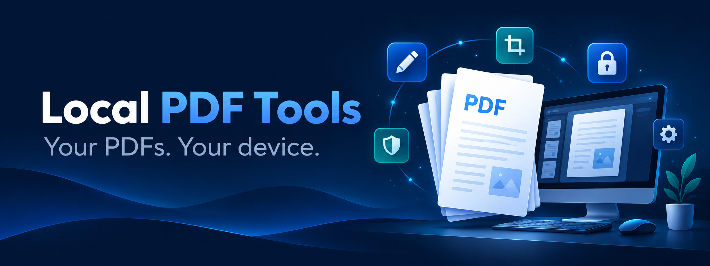

# Local PDF Tools

**Your PDFs. Your device. Your business.**

A free, MIT-licensed PDF toolkit for localpdftools.com, browsers, and Windows/macOS/Linux desktop apps. Documents are processed on the user's device. No upload backend, accounts, analytics, or cloud fallback.

[Source code](https://github.com/raakkan/local-pdf-tools) · [Report an issue](https://github.com/raakkan/local-pdf-tools/issues)

## Run locally

Use Node.js 22.12+ and pnpm 10.28.2.

```sh
pnpm install
pnpm dev
```

Open the printed local URL. Development mode does not install the offline service worker.

```sh
pnpm check
pnpm test
pnpm build
pnpm preview
# In another terminal, after build:
pnpm exec playwright install chromium
pnpm test:e2e
```

For the browser verification harness use `LOCALPDF_VERIFY=1 pnpm build`, open `/verify.html`, and rebuild normally afterward.

The production build lives in `apps/web/dist`. Offline caching is generated from the complete built asset list, including PDF.js's worker, CMaps, fonts, and WASM codecs. No CDN is required. The browser shows **Ready offline** only after the service worker verifies every asset is cached. Browser storage eviction can remove these assets.

## Included tools (20)

- Protect PDF with AES-256 encryption and an opening password.
- Unlock PDF with a known opening or owner password.
- OCR scanned PDFs into searchable PDFs and UTF-8 text with six local language packs.
- Compress PDF: lossless object/stream optimization or optional embedded-image JPEG reduction, with size comparison and an unchanged-original fallback.
- Merge PDFs in file order.
- Split or extract selected ranges, including separate pages and ZIP export.
- Organize pages: move, rotate, duplicate, reverse order, delete, insert blank pages, and undo; previews are paginated.
- JPEG/PNG to PDF with paper size, margins, and landscape controls.
- PDF pages to JPEG/PNG with resolution selection and ZIP export.
- Selectable text to UTF-8 TXT (not OCR).
- Page numbers with position, starting number, and range.
- Latin-script text watermarks with opacity and rotation.
- Draw or import a visual signature image; choose range, position, and size.

- Read-only document inspection with standard metadata, page dimensions, rotation, and JSON export.
- Edit standard metadata, or remove the Info dictionary and catalog XMP (not full sanitization).
- Alternate merge for front/back scans, with reversed back stacks and unmatched-page handling.
- Resize selected pages onto A4 or Letter with margins and preserved aspect ratios.
- Crop visible page edges by percentages, with an input-page crop overlay (not redaction).
- Headers and footers with alignment, numbering tokens, and rotated-page support.
- Two or four source pages per sheet, retaining selectable text.

Every export creates a copy. Documents stay in memory and are not persisted in browser storage. Native save dialogs permit explicitly choosing a destination; the OS may ask before replacing an existing file.

## Desktop

Install Rust stable and [Tauri platform prerequisites](https://tauri.app/start/prerequisites/), then:

```sh
pnpm desktop:dev
pnpm notices
pnpm notices:native
pnpm desktop:build
```

Tauri bundles the web application. It does not load a remote website. Native dialogs scope file access to user-selected paths. The Windows installer includes the offline WebView2 installer. Build each target on the matching OS. See [release instructions](docs/RELEASING.md).

## Architecture

| Package | Purpose |
| --- | --- |
| `packages/pdf-core` | Typed jobs, range validation, pdf-lib transformations, PDF.js adapter, worker entry |
| `packages/ui` | Shared React workspace, tools, previews, signature drawing, informational pages |
| `apps/web` | Vite entry, browser/native file adapters, bundled assets, PWA and Cloudflare headers |
| `apps/desktop` | Tauri shell and scoped native capabilities |

`runPdfJob(job, progress)` handles document transformations without React or Tauri. PDF.js renders previews/images and extracts text with its own parser worker; canvas image encoding runs one page at a time on the UI thread. Transformations run in a separate worker. Cancellation terminates the transform worker or destroys the PDF.js job. ZIP generation currently runs on the UI thread; very large exports can pause the interface during packaging.

## Document compatibility

Unencrypted, ordinary PDFs are the editing target. Read-only inspection remains available for supported unencrypted documents even when rewriting is blocked. Compression, metadata, crop, headers/footers, page numbers, watermarks, and visual signatures edit the original document without rebuilding its page tree, preserving existing standard forms, annotations/links, bookmarks, name trees/attachments, layers, and tags. Existing form appearance streams are retained without regeneration. Merge, split, organize, alternate merge, resize, and pages-per-sheet still reject these structures to avoid losing them. Digital signatures, certification/usage-rights permissions, and XFA forms remain protected from all rewriting. This is a compatibility guard, not a full PDF conformance validator or sanitizer. PDF viewing, image rendering, and text extraction use PDF.js and do not rewrite the source.

Existing-text editing, certificate signatures, redaction, Office conversion, native mobile apps, and automated updates are not included. Visual signatures are images, not cryptographic signatures. Legacy page-number, watermark, and signature tools use underlying PDF page coordinates; inspect results on pre-rotated pages. The new header/footer tool uses visible page coordinates. Watermark rotation pivots around the text origin.

Large files are constrained by device memory. Previews are bounded; image exports are sequential and capped at 32 million pixels per page. Results remain in memory until cleared, so image-heavy exports can be large. No unlimited-size claim is made.

## Hosting and community links

Deploy `apps/web/dist` to Cloudflare Pages as a static site. `_headers` supplies the production security policy and `_redirects` enables tool URL routes. Do not add a PDF upload service. Domain DNS is not changed by the build. See [release instructions](docs/RELEASING.md).

Optional build-time settings (also apply to desktop builds):

```text
VITE_REPOSITORY_URL=https://github.com/YOUR-ACCOUNT/local-pdf-tools
VITE_SPONSOR_URL=https://github.com/sponsors/YOUR-ACCOUNT
```

Use a repository URL without a trailing slash. If unset, the app accurately reports that public source links and releases are pending; it never points to an invented repository.

## License and security

Application code is MIT. Dependencies retain their licenses. `pnpm notices:native` generates host-specific Rust dependency notices. `pnpm notices` generates an installed-dependency inventory and includes upstream license files; it also inventories development dependencies. Review bundled fonts/codecs and missing notices before a public binary release. Source SVG artwork is original; the UI uses system fonts and Lucide icons.

See [CONTRIBUTING.md](CONTRIBUTING.md), [SECURITY.md](SECURITY.md), [release notes](CHANGELOG.md), and [verification status](docs/VERIFICATION.md). Sponsorship and donation links are optional; all tools remain free.

## Expansion compatibility notes

Crop margins follow the displayed orientation and existing visible box. Content outside a new crop box may remain recoverable. Metadata removal clears the standard document Info dictionary and catalog XMP stream; metadata elsewhere in the document can remain. These tools are not a document sanitizer or redaction system.

Resize centers the selected visible page area on the target paper and resets output rotation while preserving the appearance. Unselected pages keep their dimensions. Pages-per-sheet uses selected pages in order and pads the last sheet with empty spaces. Native page units affect the inspection report; paper dimensions and margins use standard PDF points.

The implementation is independent; PDFCraft's feature catalog informed the roadmap, and no AGPL implementation or assets were incorporated.

## Step 1: broader compatibility (0.3.0)

Inspect PDF now lists detected document features and the available/restricted edit operations. Empty unsigned signature fields can be retained, but actual signature dictionaries and certification permissions block rewriting. This does not add form filling, flattening, or certificate signing. New stamps are not tagged for accessibility, and preserving existing tags is not a conformance certification. Crop may hide existing form controls visually without removing them.

See [compatibility verification](docs/COMPATIBILITY_STATUS.md). Compression is implemented in version 0.4.0. OCR is implemented in version 0.5.0. Password protection and unlocking are implemented in 0.6.0. Batch processing is implemented in 0.7.0; reusable workflows and locally saved presets are available.

## Step 2: compression (0.4.0)

The default lossless mode repacks objects into object streams and recompresses eligible unfiltered/Flate streams. Existing form appearance streams are not regenerated. Stream recompression is bounded to 32 MB of decoded data per stream. Unsupported/malformed streams remain unchanged.

Optional image mode sends one eligible embedded picture at a time from the PDF worker to a local canvas JPEG encoder, then updates that picture in the original document. Text, vector content, page geometry and existing document structures remain in place. Supported images are opaque 8-bit DeviceRGB/DeviceGray raw or simple Flate images, and RGB JPEGs without EXIF/ICC metadata. Masks, transparency, predictors/custom decode parameters, color-managed images, unsupported codecs and images above 16 million pixels are skipped. JPEG quality and maximum pixel edge are user controls; this mode is lossy.

Only smaller image encodings replace existing image data. If the final serialized PDF is not smaller than its input, the returned file is an unchanged original copy. Compression never promises a target size or a reduction for every file. Signed, certified, encrypted and XFA documents remain protected.

See [compression verification](docs/COMPRESSION_STATUS.md).

### OCR

OCR PDF recognizes printed scans locally and exports a searchable copy and/or UTF-8 text. Choose English, Spanish, French, German, Hindi, or Tamil. On the website, prepare the selected language pack before disconnecting; all six are bundled in desktop builds. The optional engine/models are not part of the base PWA cache. Original artwork remains unchanged. Existing text pages are skipped by default; review all recognized words and numbers. Rotate sideways scans with Organize pages first. Maximum 16 million rendered pixels per page. Handwriting, tables, and complex layouts may need manual correction. Searchable output rejects signed/certified/XFA PDFs; text-only output does not rewrite the PDF.

### Password tools (0.6.0)

Protect PDF creates an AES-256 (revision 6) encrypted copy with an opening password. Unlock PDF accepts a known opening or owner password, including a blank password for permission-only encryption, and saves an unencrypted copy. Processing runs in a local QPDF 12.4.2 WASM worker; runtime assets are bundled and cached with the base app. Passwords are not logged or persisted in settings and fields clear after success, failure, cancellation or reset. The input is preserved. Signed, certified and XFA files cannot be rewritten. Password recovery/cracking, certificate encryption and permission editing are not included. A minimum of 8 characters is required for protection; prefer a long, unique passphrase. Maximum 127 UTF-8 bytes. See [password verification](docs/PASSWORD_STATUS.md).

### Desktop architecture

Desktop downloads are Tauri 2 applications with a native Rust shell and a bundled React web interface. Windows uses WebView2, macOS uses WKWebView and Linux uses WebKitGTK. Native dialogs handle file selection and saving; PDF manipulation runs locally in JavaScript/WebAssembly workers. All application assets are packaged with the desktop app. The website uses the same shared application as a PWA. Native Android/iOS apps are not included.

### Batch processing (0.7.0)

Enable **Process multiple PDFs separately** in compress, split, image export, text extraction, page numbers, watermark, visual signature, inspection, resize, crop, headers/footers, pages-per-sheet, OCR, protect, or unlock. Shared settings apply independently to each PDF; page ranges must be valid per document. One failed document does not stop the others. Stopping retains completed results, cancels the active file, and skips waiting files. Save successful outputs individually or as a ZIP with numbered safe source-name prefixes. Archive creation uses a cancellable worker. Password tools use the same password for each file and clear fields after the batch. Source files and completed outputs remain in session memory: use smaller groups on devices with limited memory. Merge, alternate merge, images-to-PDF, organization and metadata retain their existing workflows. See [batch status](docs/BATCH_STATUS.md).
